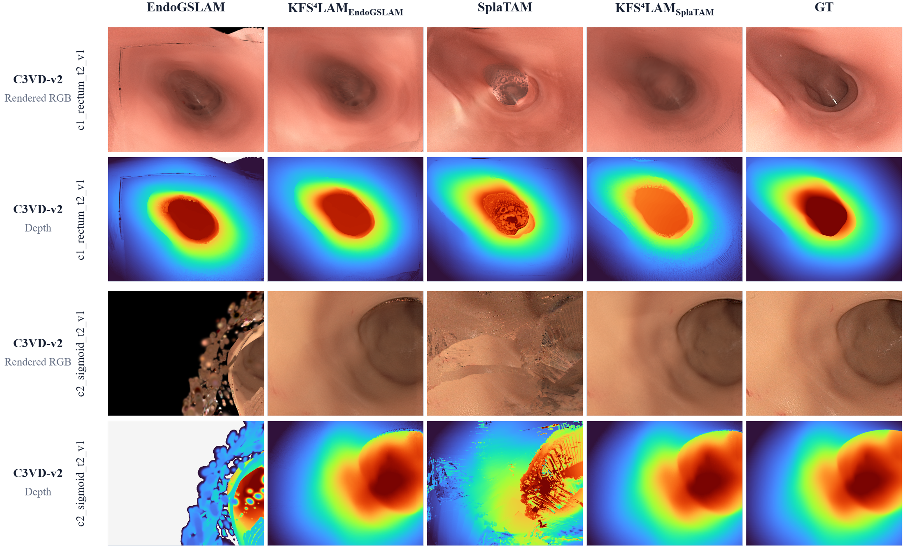
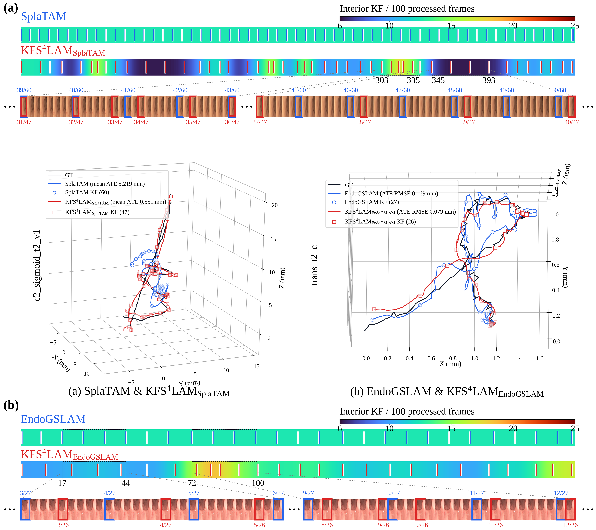

# KFS⁴LAM — Anonymous Code Release

Code for fold-aware Gaussian SLAM with adaptive keyframe observation selection and restricted temporal deformation, with **SplaTAM** and an **EndoGSLAM** adaptation. See the [checkpoint audit](CHECKPOINT_AUDIT.md): the completed EndoGSLAM reconstructions do not contain temporal deformation coefficients.


## Repository layout

```text
final/splatam/       Final SplaTAM implementation and per-sequence configurations
final/endogslam/     Final EndoGSLAM implementation and per-sequence configurations
ablations/          Separately named paper component configurations
modules/            Structure supervision, boundary distance and selection utilities
configs/            Experiment manifest and common strict-25 sequence lists
results/            Paper tables, keyframe ratios and paired metric changes
assets/             Paper figures with image metadata removed
third_party/        Optional MonoGS visibility renderer and original license
run.py              Portable entry point
```

The release contains source code and configuration files, not training checkpoints or dataset copies. The two backbones retain their evaluated implementation-specific keyframe policies and evaluation protocols; their internal settings are not assumed interchangeable.

## Environment

The experiments use Python 3.10, CUDA-enabled PyTorch, and NVIDIA V100 32GB GPUs. Install a PyTorch/CUDA combination supported by the local driver before installing the requirements. The rasterizer must be compiled against that same environment.

```bash
python -m pip install -r requirements.txt
python -m pip install 'git+https://github.com/JonathonLuiten/diff-gaussian-rasterization-w-depth.git@cb65e4b86bc3bd8ed42174b72a62e8d3a3a71110'
python run.py --list
```

For the optional MonoGS selection ablation, compile its separate renderer before use:

```bash
(cd third_party/monogs_rasterizer && python setup.py build_ext --inplace)
```

Do not replace the main depth-enabled renderer with the MonoGS renderer; the adaptation loads the latter under a separate module name. Upstream attribution and notices are in [THIRD_PARTY.md](THIRD_PARTY.md).

## Input data

RGB-D input is required: depth is an observed input to initialization, tracking and mapping. Rendered depth is a map prediction, not a replacement for input depth. Use registered, undistorted RGB/depth and spatially aligned continuous fold responses.

```text
C3VD_ROOT/sequence/color/0000.png
C3VD_ROOT/sequence/depth/0000.tiff
C3VD_V2_ROOT/sequence/rgb/0000.png
C3VD_V2_ROOT/sequence/depth/0000_depth.tiff
FOLD_ROOT/sequence/0000_color.npy
```

Keep the original pose files expected by each dataset loader beside these images. The paper uses the camera calibration in `final/<backbone>/configs/data/`; depth uses the dataset scale 655.35 integer units per millimetre. See the dataset loaders for the exact source pose convention and filename handling.

Fold inputs are continuous arrays in [0,1]; the published runs use channel 0 of the four-channel float32 original-Docker outputs produced with the reproduced predictor. Fold inference is external to this repository. Resize to the mapping resolution with the exported nearest-neighbour convention; RGB/fold distortion and cropping must agree. No binary threshold is applied to the stored Gaussian fold attribute. Boundary-support thresholding is used only to construct the target distance transform.

## Run the final methods

```bash
python run.py --backbone splatam --dataset c3vd_v2 \
  --sequence c1_rectum_t2_v1 --dataset-root /path/to/C3VD_V2_ROOT \
  --fold-root /path/to/FOLD_ROOT --output outputs/splatam_rectum --gpu 0

python run.py --backbone endogslam --dataset c3vd_v2 \
  --sequence c1_rectum_t2_v1 --dataset-root /path/to/C3VD_V2_ROOT \
  --fold-root /path/to/FOLD_ROOT --output outputs/endogslam_rectum --gpu 0
```

Use `--dry-run` to inspect the resolved configuration. `--frames`, `--mapping-iters` and `--tracking-iters` are smoke-test overrides and do not reproduce paper numbers. `--cpu-offload` offloads autograd saved tensors without changing the loss definition; it was needed for one fixed-keyframe deformation control due to GPU memory exhaustion.

```bash
python run.py --backbone splatam --variant structure_guided_deformation \
  --dataset c3vd_v2 --sequence c1_rectum_t2_v1 \
  --dataset-root /path/to/C3VD_V2_ROOT --fold-root /path/to/FOLD_ROOT \
  --output outputs/fixed_keyframe_control --gpu 0
```

See [the ablation matrix](ablations/README.md) for all paper names. The final Full configuration is selected with `--variant full` (the default).

## Implementation conventions

- Poses are **world-to-camera**. The implemented accumulated-motion selector uses changes in the stored world-to-camera translation component as a **motion proxy**, not world-frame camera travel distance. Camera centers would instead be `-R.T @ t`.
- SplaTAM mapping runs at every input frame; retained-keyframe selection happens after mapping. Mapping replays current and retained historical observations.
- Fold supervision uses the one-sided mean product of rendered Sobel boundary magnitude and stop-gradient target Boundary-DT, capped at 10 pixels. The branch detaches stored fold attributes and the mapping pose.
- Restricted temporal deformation changes Gaussian means with six coefficients and the basis `[u, sin(pi*u)]`. Larger fold response reduces the displacement penalty through `1 - 0.5*f`; it does not enforce greater rigidity on folds.
- Tracking freezes the map and temporal coefficients and optimizes pose using the backbone RGB/depth objective.
- DynMap uses a 25–75 iteration budget. Equal budget rules do not imply equal realized iteration counts across different keyframe histories.

## Evaluation

```bash
python evaluate.py --run outputs/splatam_rectum --backbone splatam --dataset c3vd_v2 --gpu 0
```

Use `paper_metrics.json` for the paper protocol. SplaTAM's legacy native console depth labels are not the paper depth-RMSE computation; this evaluator rerenders the saved evaluation frames and computes true pixelwise RMSE in millimetres. Pose metrics use Sim(3) alignment and relative errors on adjacent evaluated poses. EndoGSLAM retains its native held-out rendering protocol and evaluates saved RGB/depth against dataset observations; it is not the same frame sampling as SplaTAM. This release preserves those evaluated protocols rather than silently standardizing them.

## Qualitative results






These are qualitative observed-frame reconstruction examples, not proof of held-out novel-view generalization. The supplied trajectory illustration uses the existing historical EndoGSLAM trajectory example; it should not be interpreted as a new quantitative result of the final reproduced-predictor configuration. The numerical results below use the final configurations stated in the table.

## Quantitative results

The common evaluation pool contains 14 C3VD and 11 C3VD-v2 sequences (10,675 total input frames). Accuracy/rendering metrics are macro means over sequences. wKF is `100 * total retained keyframes / total input frames`; it is descriptive, not ranked. EndoGSLAM holds out frames during reconstruction, so its processed-frame denominator differs; this table uses full input lengths consistently.

### C3VD

| Method | m ATE ↓ | m ARE ↓ | RPE-t ↓ | RPE-r ↓ | PSNR ↑ | SSIM ↑ | LPIPS ↓ | Depth RMSE ↓ | wKF (%) |
|---|---:|---:|---:|---:|---:|---:|---:|---:|---:|
| EndoGSLAM | 0.5377 | 10.7657 | 0.0888 | 0.1617 | 21.1734 | 0.7319 | 0.3111 | 2.6904 | 11.2737 |
| KFS4LAM_EndoGSLAM | 0.5276 | 12.1956 | 0.0870 | 0.1605 | 21.7622 | 0.7379 | 0.3013 | 2.5875 | 10.9639 |
| SplaTAM | 0.4544 | 10.3404 | 0.0625 | 0.1464 | 25.6437 | 0.8776 | 0.2416 | 1.1509 | 12.8571 |
| SplaTAM + DynMap | 0.4542 | 10.3180 | 0.0652 | 0.1533 | 25.6556 | 0.8765 | 0.2429 | 1.1729 | 12.8571 |
| SplaTAM + Structure-Guided | 0.4541 | 10.3959 | 0.0639 | 0.1480 | 25.6586 | 0.8776 | 0.2425 | 1.2016 | 12.8571 |
| SplaTAM + Motion-Guided | 0.4563 | 9.2655 | 0.0644 | 0.1527 | 25.4654 | 0.8726 | 0.2445 | 1.1165 | 12.3408 |
| SplaTAM + Motion-and-Structure-Guided | 0.4526 | 10.0100 | 0.0644 | 0.1528 | 25.5632 | 0.8708 | 0.2445 | 1.1672 | 12.3408 |
| SplaTAM + Motion Proposal Only | 0.4390 | 10.1672 | 0.0644 | 0.1531 | 25.5869 | 0.8731 | 0.2403 | 1.1675 | 12.3924 |
| SplaTAM + Structure-Guided + Deformation | 0.4394 | 9.4965 | 0.0612 | 0.1445 | 26.8518 | 0.8906 | 0.2206 | 1.0710 | 12.8571 |
| SplaTAM + MonoGS KFS | 0.4506 | 9.6455 | 0.0646 | 0.1503 | 25.1288 | 0.8679 | 0.2423 | 1.1682 | 5.8692 |
| KFS4LAM_SplaTAM (Ours) | 0.4476 | 9.3457 | 0.0624 | 0.1418 | 26.6164 | 0.8835 | 0.2206 | 1.0720 | 12.2719 |

### C3VD-v2

| Method | m ATE ↓ | m ARE ↓ | RPE-t ↓ | RPE-r ↓ | PSNR ↑ | SSIM ↑ | LPIPS ↓ | Depth RMSE ↓ | wKF (%) |
|---|---:|---:|---:|---:|---:|---:|---:|---:|---:|
| EndoGSLAM | 7.5037 | 60.1639 | 0.4411 | 1.2234 | 14.6158 | 0.5615 | 0.6484 | 14.8925 | 11.2641 |
| KFS4LAM_EndoGSLAM | 7.6249 | 56.0092 | 0.4277 | 0.9274 | 15.3012 | 0.5977 | 0.6082 | 11.9277 | 11.0586 |
| SplaTAM | 7.6836 | 59.4920 | 0.3103 | 1.3969 | 20.1354 | 0.7053 | 0.4257 | 4.9467 | 12.8263 |
| SplaTAM + DynMap | 7.4050 | 64.2583 | 0.3305 | 1.6571 | 19.7124 | 0.6862 | 0.4391 | 5.4341 | 12.8263 |
| SplaTAM + Structure-Guided | 7.8456 | 86.6674 | 0.3647 | 1.7653 | 18.8259 | 0.6713 | 0.4400 | 5.1511 | 12.8263 |
| SplaTAM + Motion-Guided | 7.9316 | 86.6297 | 0.3419 | 1.4513 | 19.1381 | 0.6587 | 0.4488 | 4.6965 | 12.3330 |
| SplaTAM + Motion-and-Structure-Guided | 7.5029 | 61.2326 | 0.4090 | 1.3490 | 20.7760 | 0.7206 | 0.4290 | 4.3053 | 12.3124 |
| SplaTAM + Motion Proposal Only | 6.3700 | 67.1338 | 0.3379 | 1.1344 | 19.2783 | 0.6560 | 0.4704 | 4.5818 | 12.8263 |
| SplaTAM + Structure-Guided + Deformation | 7.5588 | 55.1991 | 0.3258 | 1.1722 | 19.3904 | 0.6778 | 0.4303 | 4.0610 | 12.8263 |
| SplaTAM + MonoGS KFS | 7.7974 | 56.8667 | 0.3599 | 1.4378 | 19.6507 | 0.6757 | 0.4475 | 5.2921 | 9.2086 |
| KFS4LAM_SplaTAM (Ours) | 7.2429 | 44.8062 | 0.3764 | 1.1134 | 20.9113 | 0.7163 | 0.4332 | 3.0472 | 12.4152 |

The strongest consistent effect in these runs is restricted deformation. With deformation and fold supervision held at the same settings, adaptive keyframe selection improves six of eight aggregate metrics on C3VD-v2 relative to the fixed-interval control; effects on C3VD are mixed. The results do not establish universal necessity of adaptive keyframe selection or significance across random seeds.

[LaTeX table](results/component_results.tex) · [Keyframe summaries](results/kf_summary.csv) · [All 275 per-sequence keyframe records](results/kf_per_sequence.csv) · [Paired metric changes](results/paired_metric_changes.csv)

## Project page and reconstruction archives

Open [the anonymous project page](docs/index.html) through a static HTTP server. It includes local figures, quantitative tables and checkpoint re-render videos. Hosting and anonymous download URLs are pending repository access.

The separate result release contains 50 archives: two backbones × 25 sequences. To render a downloaded reconstruction without the source dataset:

```bash
python render_checkpoint.py --backbone splatam --checkpoint params.npz --frames all --stride 8 --output rendered
```

Outputs are RGB PNGs and raw depth NPYs; depth is not min–max normalized. Use `--backbone endogslam` for EndoGSLAM. Frame numbers refer to processed frames, with the original EndoGSLAM training split retained.

To compose a camera/trajectory replay from rendered RGB frames:

```bash
python tools/compose_camera_replay.py --checkpoint params.npz --renders rendered --output camera_replay.mp4 --method 'KFS4LAM (SplaTAM)' --sequence trans_t2_b
```

The project page offers synchronized camera/trajectory and reconstruction videos for `trans_t2_b` and `c1_rectum_t2_v1`, for both backbones.
