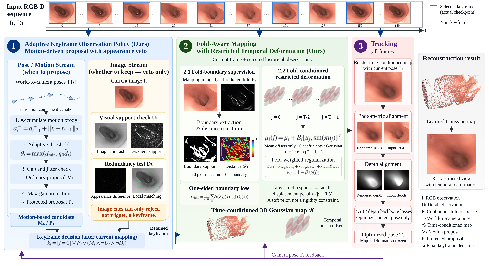
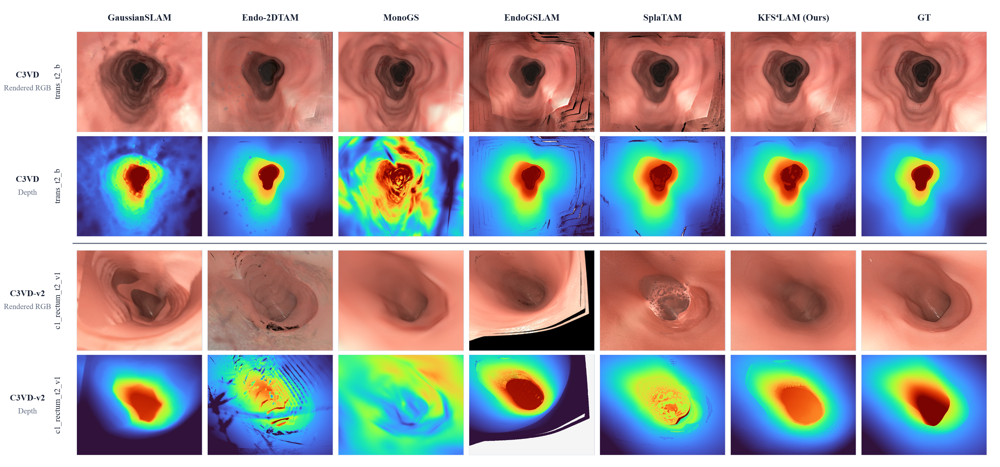

# KFS⁴LAM: Adaptive KeyFrame Selection with Structure-Aware Mapping for Endoscopic Gaussian Splatting SLAM

[Project Page](https://anonymous4submission123.github.io/KFS4LAM_Submission/) · [Videos](#videos) · [Installation & Usage](USAGE.md)

KFS⁴LAM combines adaptive keyframe selection with fold-boundary supervision and restricted temporal deformation for endoscopic Gaussian splatting SLAM.



## Main results

Best values per dataset and metric are **bold**; displayed ties share the rank.

Sequence means over 14 C3VD and 11 C3VD-v2 sequences. Pose translation errors are in mm and rotation errors in degrees. Rendering follows each backbone’s evaluation protocol; depth values retain the source evaluator’s scale. [LaTeX](results/main_results.tex) · [Per-sequence results](results/main_per_sequence.json)

### C3VD

| Method | m ATE ↓ | m ARE ↓ | RPE-t ↓ | RPE-r ↓ | PSNR ↑ | SSIM ↑ | LPIPS ↓ | Depth RMSE ↓ |
|---|---:|---:|---:|---:|---:|---:|---:|---:|
| GaussianSLAM | 4.0885 | 77.3899 | 0.3392 | 0.1930 | 25.7629 | 0.7498 | 0.5148 | 6.5036 |
| Endo-2DTAM | 1.5718 | 47.2588 | 0.1321 | 0.6578 | 20.2745 | 0.7867 | 0.3603 | 9.0555 |
| MonoGS | 2.7190 | 63.4965 | 0.3791 | 0.5640 | **29.6784** | 0.8482 | 0.3824 | 1430.0773 |
| EndoGSLAM | 0.5377 | 10.7657 | 0.0888 | 0.1617 | 21.1734 | 0.7319 | 0.3111 | 2.6904 |
| SplaTAM | 0.4544 | 10.3404 | 0.0625 | 0.1464 | 25.6437 | 0.8776 | 0.2416 | 1.1509 |
| KFS⁴LAM | **0.4476** | **9.3457** | **0.0624** | **0.1418** | 26.6164 | **0.8835** | **0.2206** | **1.0720** |

### C3VD-v2

| Method | m ATE ↓ | m ARE ↓ | RPE-t ↓ | RPE-r ↓ | PSNR ↑ | SSIM ↑ | LPIPS ↓ | Depth RMSE ↓ |
|---|---:|---:|---:|---:|---:|---:|---:|---:|
| GaussianSLAM | 10.9947 | 104.4292 | 0.7494 | **0.4394** | 22.9059 | 0.6604 | 0.6127 | 10.1778 |
| Endo-2DTAM | 10.9641 | 93.3534 | 0.4446 | 2.4587 | 18.3417 | 0.6850 | 0.4917 | 14.5562 |
| MonoGS | 7.8102 | 69.8136 | 0.5809 | 1.6017 | **25.7714** | **0.7740** | 0.6115 | 1071.4941 |
| EndoGSLAM | 7.5037 | 60.1639 | 0.4411 | 1.2234 | 14.6158 | 0.5615 | 0.6484 | 14.8925 |
| SplaTAM | 7.6836 | 59.4920 | **0.3103** | 1.3969 | 20.1354 | 0.7053 | **0.4257** | 4.9467 |
| KFS⁴LAM | **7.2429** | **44.8062** | 0.3764 | 1.1134 | 20.9113 | 0.7163 | 0.4332 | **3.0472** |

## Rendering comparison



RGB and depth reconstruction on **trans_t2_b (C3VD)** and **c1_rectum_t2_v1 (C3VD-v2)**. [View full-resolution figure](assets/render_comparison.png).

## Videos

Synchronized RGB and depth comparisons above a progressively accumulated observed surface, moving camera, GT/baseline/KFS⁴LAM trajectories, and the current render.

| Sequence | Comparison | Video |
|---|---|---|
| c2_sigmoid_t2_v1 | SplaTAM backbone | [Watch / download](https://anonymous4submission123.github.io/KFS4LAM_Submission/assets/c2_sigmoid_t2_v1__comparison_rgbd_surface.mp4) |
| trans_t2_b | Main | [Watch / download](https://anonymous4submission123.github.io/KFS4LAM_Submission/assets/trans_t2_b__comparison_rgbd_surface.mp4) |
| trans_t2_c | EndoGSLAM backbone | [Watch / download](https://anonymous4submission123.github.io/KFS4LAM_Submission/assets/trans_t2_c__comparison_rgbd_surface.mp4) |

Local surface patches accumulate from final-checkpoint rendered observations, preserving gaps; these are not intermediate optimization snapshots. EndoGSLAM comparisons assess whether keyframe selection and fold supervision transfer beyond the primary SplaTAM backbone.

## Reconstruction replay

Anonymous checkpoint downloads are not yet available. To render an existing reconstruction archive, extract it and run after [installation](USAGE.md):

```bash
python render_checkpoint.py --backbone splatam --checkpoint params.npz --frames all --output rendered
```

The synchronized camera/trajectory videos are available in the [Videos](#videos) section.

## Code & ablations

- `final/splatam/`, `final/endogslam/`: backbone implementations and configurations.
- `modules/`: keyframe selection and fold supervision.
- `ablations/`: [component settings](ablations/README.md); [component results](results/component_results.tex).
- `docs/`: project-page source, figures and videos.

## References

- **C3VD** — Bobrow et al., *Colonoscopy 3D Video Dataset with Paired Depth from 2D–3D Registration*, Medical Image Analysis, 2023. [Dataset](https://durrlab.github.io/C3VD/) · [Paper](https://arxiv.org/abs/2206.08903)
- **C3VD-v2** — Golhar et al., *C3VDv2: Colonoscopy 3D Video Dataset with Enhanced Realism*, Scientific Data, 2026. [Dataset & citation](https://durrlab.github.io/C3VDv2/)
- **SplaTAM** — Keetha et al., *SplaTAM: Splat, Track & Map 3D Gaussians for Dense RGB-D SLAM*, CVPR 2024. [Paper](https://arxiv.org/abs/2312.02126) · [Code](https://github.com/spla-tam/SplaTAM)
- **EndoGSLAM** — *Real-Time Dense Reconstruction and Tracking in Endoscopic Surgeries using Gaussian Splatting*, MICCAI 2024. [Paper](https://arxiv.org/abs/2403.15124) · [Code](https://github.com/Loping151/EndoGSLAM)

Additional implementation attribution and licenses: [third-party notices](THIRD_PARTY.md).
